# Lab: Quantum Programming with Qiskit on Linux

Course: Computer Architecture (SIS-131) · Instructor: Eng. Paulo César Loayza Carrasco · Student: Alain Flores

This lab follows the guide *"Programación Cuántica con Qiskit en Linux Ubuntu"*. It sets up the environment, simulates four quantum circuits
(the Bell state, rotations on the Bloch sphere, Deutsch's algorithm, and quantum teleportation), solves the two practical challenges,
and answers the evaluation questionnaire.

> **Environment transparency:** every run and screenshot in this folder is **real** output, produced on a Linux machine
> **Debian 13 (trixie), x86_64, Python 3.13.5**, with **Qiskit 2.6.2**, **qiskit-aer 0.18.4**, and **matplotlib 3.11.2** (not on an Ubuntu 22.04/24.04 VM
> as the guide specifies, which also refers to Qiskit 1.x). The commands are the same, and Debian 13 enforces PEP 668 as well.
> Counts vary slightly from run to run because the measurements are random, so they do not match the guide digit for digit.
> The plots in `figuras/` come from a separate run (`generar_figuras.py`), so their exact counts can differ slightly from the console output.

## Folder contents

| File | Description |
|---|---|
| `requirements.txt` | Python dependencies (`qiskit`, `qiskit-aer`, `matplotlib`, `pylatexenc`) |
| `lab1_hola_mundo.py` | Lab 1 · Bell state \|Φ+⟩ |
| `lab2_rotaciones_bloch.py` | Lab 2 · Ry(θ) rotations and the Bloch sphere |
| `lab3_algoritmo_deutsch.py` | Lab 3 · Deutsch's algorithm |
| `lab4_teletransportacion.py` | Lab 4 · Quantum teleportation |
| `reto1_bell_psi_plus.py` | Challenge 1 · Bell state \|Ψ+⟩ |
| `reto2_deutsch_sin_x.py` | Challenge 2 · Deutsch without the X gate on the ancilla |
| `generar_figuras.py` | Builds the PNG plots with the non-interactive backend (`Agg`) into `figuras/` |
| `demo_advertencia_backend.py` / `solucion_guardar_figuras.py` | Reproduce and fix the `FigureCanvasAgg is non-interactive` warning |
| `herramientas/txt_a_png.py` | Turns console output (.txt) into a terminal-style screenshot (.png) |
| `evidencias/` | Real output of each run (`.txt`) and the matching screenshots (`.png`) |
| `figuras/` | Circuits, histograms, the probability curve, and Bloch spheres (PNG) |

## 1. Environment and installation

Steps from the guide (section 1):

```bash
# 1.1 y 1.2 (en Ubuntu)
sudo apt update && sudo apt upgrade -y
sudo apt install -y python3 python3-pip python3-venv python3-dev build-essential git

# 1.3 carpeta de trabajo
mkdir -p ~/laboratorio_cuantica && cd ~/laboratorio_cuantica

# 1.4 entorno virtual aislado (necesario por PEP 668)
python3 -m venv .venv
source .venv/bin/activate

# 1.5 dependencias
pip install --upgrade pip
pip install qiskit qiskit-aer matplotlib pylatexenc      # o: pip install -r requirements.txt

# 1.6 verificación
python3 -c "import qiskit, qiskit_aer; print('Qiskit Core:', qiskit.__version__); print('Aer Simulator OK')"
```

What was actually done on the test machine: the `.venv` was created and the four packages were installed with `pip`. **`sudo apt update && sudo apt upgrade` was not run**
(this is a shared machine), and `build-essential` / `python3-dev` were not installed. They were not needed, because `qiskit-aer` came from a prebuilt wheel.

Real verification output (`evidencias/00_verificacion_instalacion.txt`):

```text
Qiskit Core: 2.6.2
Aer Simulator OK
```

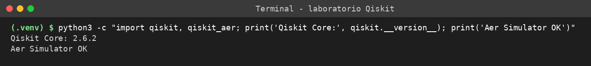

Versions and system (`evidencias/01_entorno.txt`):

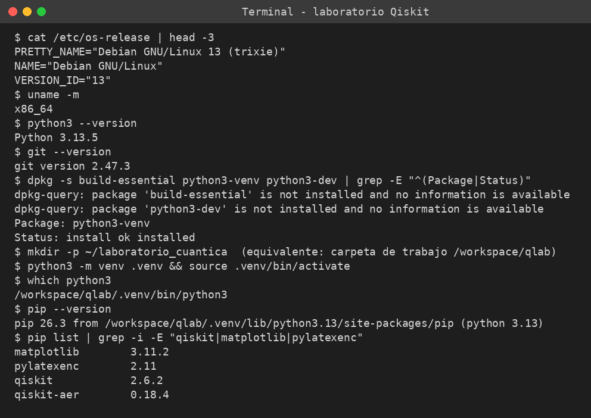

## 2. How to run each script

With the virtual environment activated, from this folder:

```bash
python3 lab1_hola_mundo.py
python3 lab2_rotaciones_bloch.py
python3 lab3_algoritmo_deutsch.py
python3 lab4_teletransportacion.py
python3 reto1_bell_psi_plus.py
python3 reto2_deutsch_sin_x.py
python3 generar_figuras.py        # crea los PNG en figuras/ (sin ventana gráfica)
```

## 3. Results

### Lab 1 · Bell state |Φ+⟩ = (|00⟩ + |11⟩)/√2

Circuit: a Hadamard on q0 and a CNOT (control q0, target q1), then measurement. 10 000 shots.

```text
CIRCUITO CUÁNTICO:
     ┌───┐     ┌─┐   
q_0: ┤ H ├──■──┤M├───
     └───┘┌─┴─┐└╥┘┌─┐
q_1: ─────┤ X ├─╫─┤M├
          └───┘ ║ └╥┘
c: 2/═══════════╩══╩═
                0  1 

RESULTADOS DE LA MEDICIÓN (10000 disparos):
Estado |00⟩: 5031 ocurrencias (50.31%)
Estado |11⟩: 4969 ocurrencias (49.69%)
```

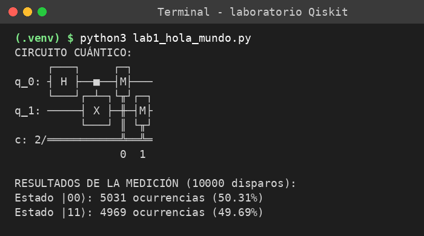
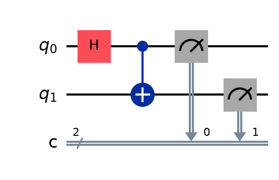


Only `00` and `11` appear (≈50% each): the two qubits are fully correlated. `01` and `10` do not appear.

### Lab 2 · Rotations on the Bloch sphere

Ry(θ) is applied to |0⟩ and the qubit is measured: P(|0⟩) = cos²(θ/2), P(|1⟩) = sin²(θ/2).

```text
Polo Norte (theta = 0)              -> P(|0⟩): 100.0% | P(|1⟩):   0.0%
Ángulo 45° (theta = pi/4)           -> P(|0⟩):  85.7% | P(|1⟩):  14.3%
Ecuador (theta = pi/2, Estado |+>)  -> P(|0⟩):  50.0% | P(|1⟩):  50.0%
Polo Sur (theta = pi, Estado |1>)   -> P(|0⟩):   0.0% | P(|1⟩): 100.0%
```

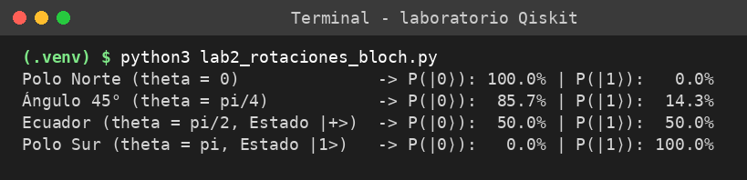
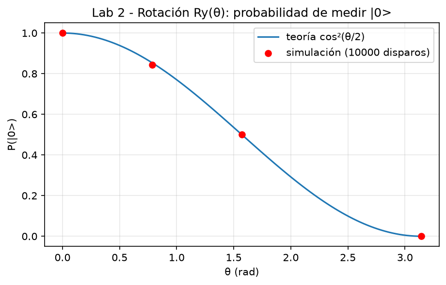
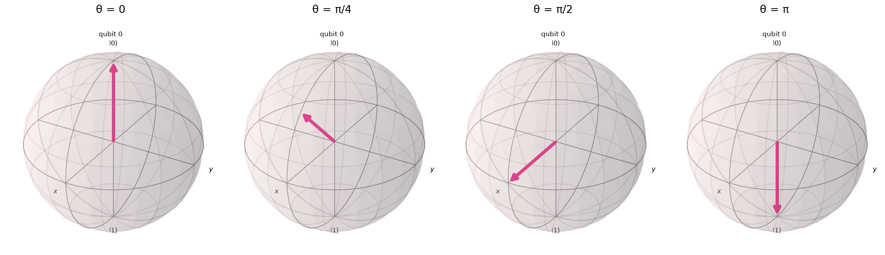

At θ = π/4, theory gives cos²(π/8) ≈ 85.36%; the simulation gave 85.7%, within the statistical error of 10 000 shots (σ ≈ 0.35%).

### Lab 3 · Deutsch's algorithm

A single query to the oracle decides whether f is constant (measure `0`) or balanced (measure `1`).

```text
Oráculo: constante_0            | Medición q0: '0' -> Función CONSTANTE
Oráculo: constante_1            | Medición q0: '0' -> Función CONSTANTE
Oráculo: balanceada_identidad   | Medición q0: '1' -> Función BALANCEADA
Oráculo: balanceada_inversa     | Medición q0: '1' -> Función BALANCEADA
```

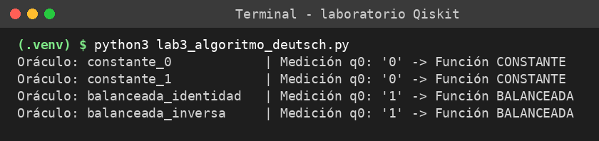
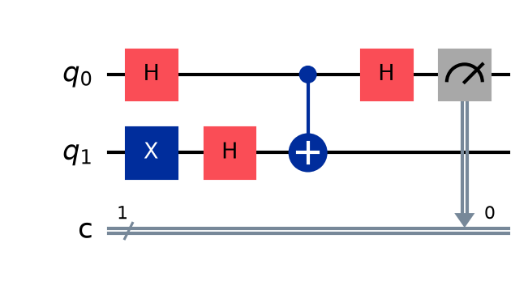
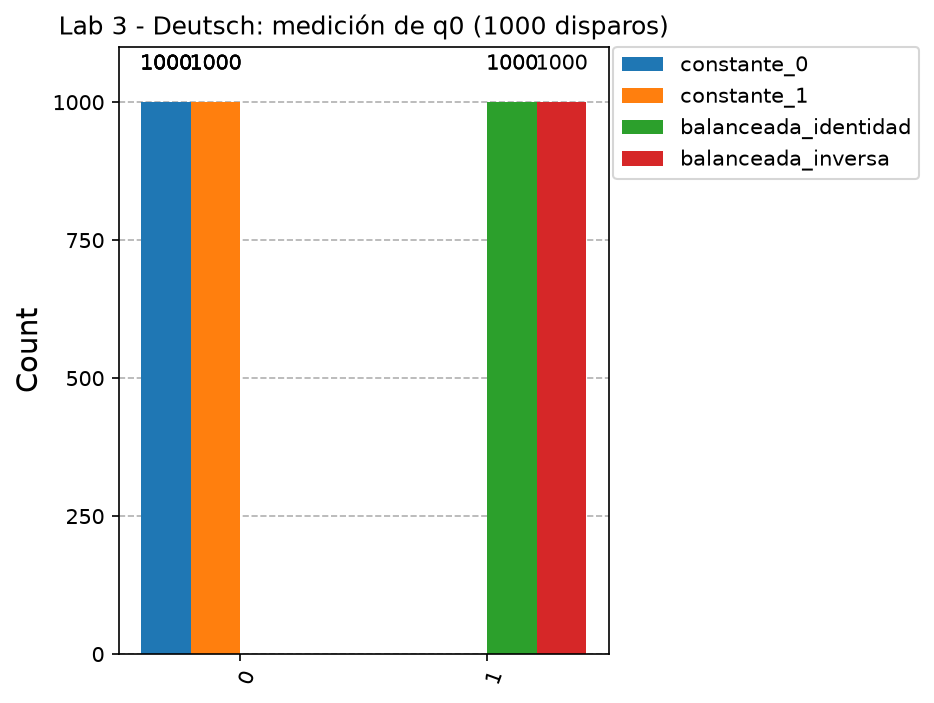

### Lab 4 · Quantum teleportation

The state Ry(π/3)|0⟩ = (√3/2)|0⟩ + (1/2)|1⟩ is teleported from q0 (Alice) to q2 (Bob). Theory: P(|0⟩) = 75%, P(|1⟩) = 25%.

```text
VERIFICACIÓN EN EL CÚBIT DE BOB (q2):
P(|0⟩): 75.25% (Teórico: 75.00%)
P(|1⟩): 24.75% (Teórico: 25.00%)
```

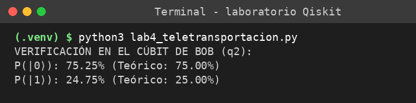
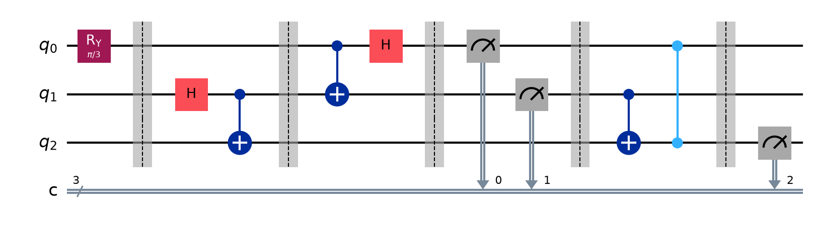
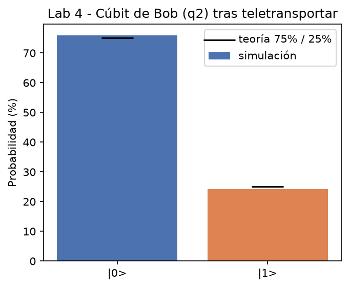

Note: Bob's corrections (`cx(1, 2)` and `cz(0, 2)`) are implemented as gates controlled by the measured qubits (the deferred-measurement principle),
just as in the guide. The result is equivalent to correcting with the classical bits that were received.
In Qiskit the leftmost bit of the result string is the highest-index qubit, so `bitstring[0]` reads q2.

### Challenge 1 · Bell state |Ψ+⟩ = (|01⟩ + |10⟩)/√2

A **Pauli-X on q1** is added after the CNOT (see `reto1_bell_psi_plus.py`). The state vector is also printed before measurement.

```text
VECTOR DE ESTADO (orden Qiskit |q1 q0>):
  |00>: +0.0000+0.0000j
  |01>: +0.7071+0.0000j
  |10>: +0.7071+0.0000j
  |11>: +0.0000+0.0000j

CIRCUITO CUÁNTICO (Reto 1):
     ┌───┐          ┌─┐   
q_0: ┤ H ├──■───────┤M├───
     └───┘┌─┴─┐┌───┐└╥┘┌─┐
q_1: ─────┤ X ├┤ X ├─╫─┤M├
          └───┘└───┘ ║ └╥┘
c: 2/════════════════╩══╩═
                     0  1 

RESULTADOS DE LA MEDICIÓN (10000 disparos):
Estado |01⟩: 5070 ocurrencias (50.70%)
Estado |10⟩: 4930 ocurrencias (49.30%)
```

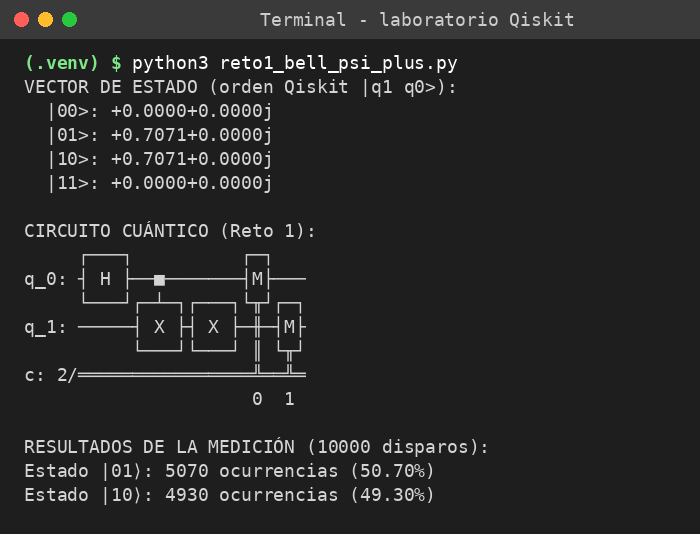
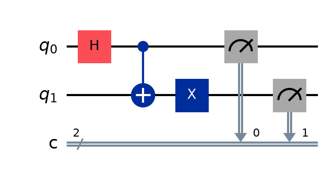
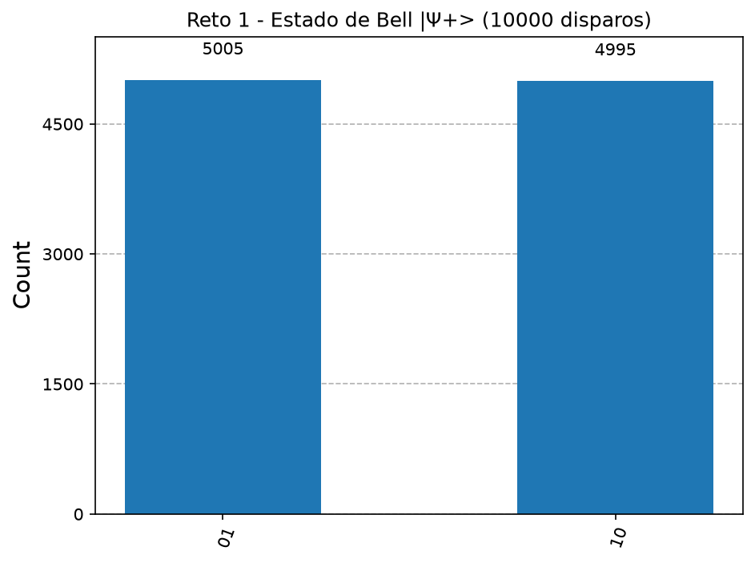

### Challenge 2 · Deutsch without the X on the ancilla

All four oracles are run with and without `qc.x(1)`.

```text
=== CON X en la ancilla (correcto) ===
Oráculo: constante_0            | conteos q0: {'0': 1000} -> CONSTANTE  | real: CONSTANTE  | OK
Oráculo: constante_1            | conteos q0: {'0': 1000} -> CONSTANTE  | real: CONSTANTE  | OK
Oráculo: balanceada_identidad   | conteos q0: {'1': 1000} -> BALANCEADA | real: BALANCEADA | OK
Oráculo: balanceada_inversa     | conteos q0: {'1': 1000} -> BALANCEADA | real: BALANCEADA | OK

=== SIN X en la ancilla (Reto 2) ===
Oráculo: constante_0            | conteos q0: {'0': 1000} -> CONSTANTE  | real: CONSTANTE  | OK
Oráculo: constante_1            | conteos q0: {'0': 1000} -> CONSTANTE  | real: CONSTANTE  | OK
Oráculo: balanceada_identidad   | conteos q0: {'0': 1000} -> CONSTANTE  | real: BALANCEADA | ERROR (veredicto incorrecto)
Oráculo: balanceada_inversa     | conteos q0: {'0': 1000} -> CONSTANTE  | real: BALANCEADA | ERROR (veredicto incorrecto)
```

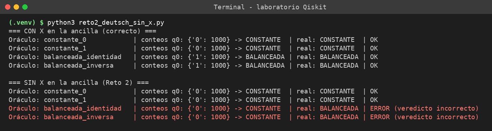
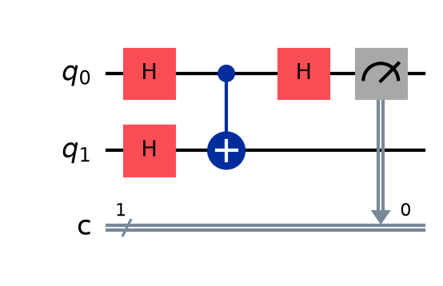
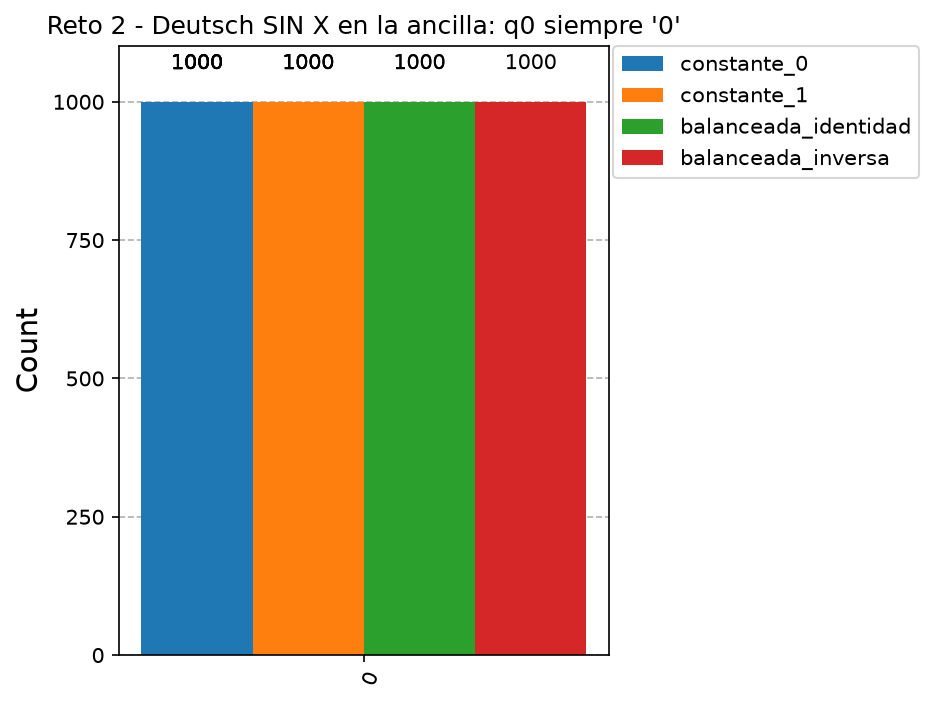

Without the X the result is always `0`: both balanced oracles are misclassified as constant.

## 4. Problems found and how they were solved

These problems came up while running the lab (they are listed in the table in section 7 of the guide):

**a) `error: externally-managed-environment` (PEP 668).** Trying `pip install` with the system Python (`/usr/bin/python3`) makes pip refuse to install.
Fix: create and activate a `.venv` virtual environment (do not use `--break-system-packages`). This was checked with `--dry-run` so the system was left untouched.

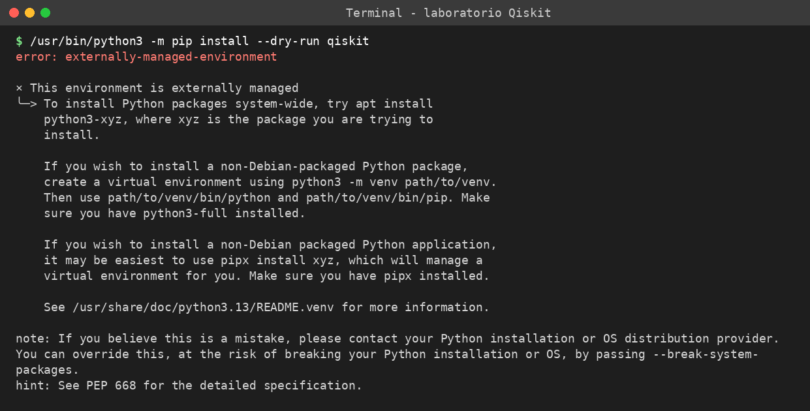

**b) `UserWarning: FigureCanvasAgg is non-interactive, and thus cannot be shown`.** This happens when `plt.show()` is called with no display (the `Agg` backend).
Fix: do not show the figure; save it with `savefig` (or use `qc.draw(output="text")`).

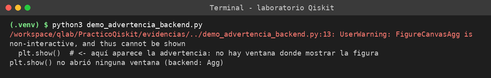
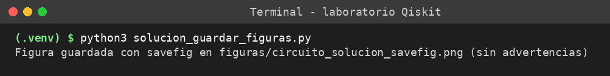

**c) Differences from the guide** (these are not errors): Debian 13 instead of Ubuntu; Qiskit 2.6.2 instead of 1.x (all four scripts ran with no change in logic);
and the guide prints `■` where the ket `⟩` belongs (a PDF encoding problem), which was corrected to `⟩` when the scripts were transcribed.
The build error `Building wheel for qiskit-aer failed` **did not occur** (a prebuilt wheel was installed).

## 5. Evaluation questionnaire

**1. Why does a Hadamard on |0⟩ give a 50% chance of measuring 0 or 1, while the state stays pure?**
H|0⟩ = (|0⟩ + |1⟩)/√2 = |+⟩. The amplitudes are 1/√2 and the probabilities are |1/√2|² = 1/2. The state is still one normalized state vector
(a *coherent superposition*, not a statistical mixture of |0⟩ and |1⟩): its density matrix is ρ = |+⟩⟨+| and Tr(ρ²) = 1. On the Bloch sphere it sits on the equator
(a vector of length 1). The randomness shows up only when measuring in the Z basis. H is also unitary and reversible (H|+⟩ = |0⟩), so no information is lost before the measurement.

**2. In |Φ+⟩ = (|00⟩ + |11⟩)/√2, if the first qubit yields 1, what is the probability that the second yields 0?**
It is **0%** (probability exactly 0). Measuring 1 on the first qubit projects the state onto |11⟩, so the second qubit is 1 with probability 1. That matches the simulation: `01` and `10` never appear.

**3. Challenge 1: which Pauli, and on which qubit, produces |Ψ+⟩ = (|01⟩ + |10⟩)/√2?**
A **Pauli-X** gate on qubit q1, applied after the CNOT: X₁(|00⟩ + |11⟩)/√2 = (|01⟩ + |10⟩)/√2. X on q1 before the CNOT also works, as does X on q0 after the CNOT.
Checked in `reto1_bell_psi_plus.py`: the state vector has amplitude 0.7071 on `01` and on `10`, and the simulation returns only those two outcomes (≈50% each).

**4. Challenge 2: what happens in Deutsch's algorithm if the X on ancilla q1 is left out?**
Without the X, the ancilla starts in |0⟩ and the Hadamard leaves it in |+⟩ instead of |−⟩. |+⟩ is an eigenstate of X with eigenvalue +1, so the oracle acts as U_f|x⟩|+⟩ = |x⟩|+ ⊕ f(x)⟩ = |x⟩|+⟩.
There is **no phase kickback**: the phase (−1)^f(x) never appears on q0. The first qubit stays in |+⟩, the final Hadamard returns it to |0⟩, and the measurement is always `0`, whether f is constant or balanced.
The algorithm therefore misclassifies the balanced functions (2 of the 4 oracles come out wrong in the Challenge 2 run). Putting the ancilla in |−⟩ is what turns the value of f into a relative phase on q0.

**5. Why doesn't quantum teleportation allow faster-than-light communication?**
Entanglement correlates Alice and Bob at once, but Alice's measurement (two bits) is completely random: the four outcomes 00, 01, 10, and 11 are equally likely.
Until those two bits arrive, Bob's qubit is in the maximally mixed state I/2, independent of the state |ψ⟩ being sent, so Bob cannot learn anything (the no-signaling theorem).
Only after the two classical bits arrive, over an ordinary channel and therefore no faster than light, does Bob know which correction to apply (X and/or Z) and recover |ψ⟩.
Measuring also destroys Alice's original state, which is what the no-cloning theorem requires.
